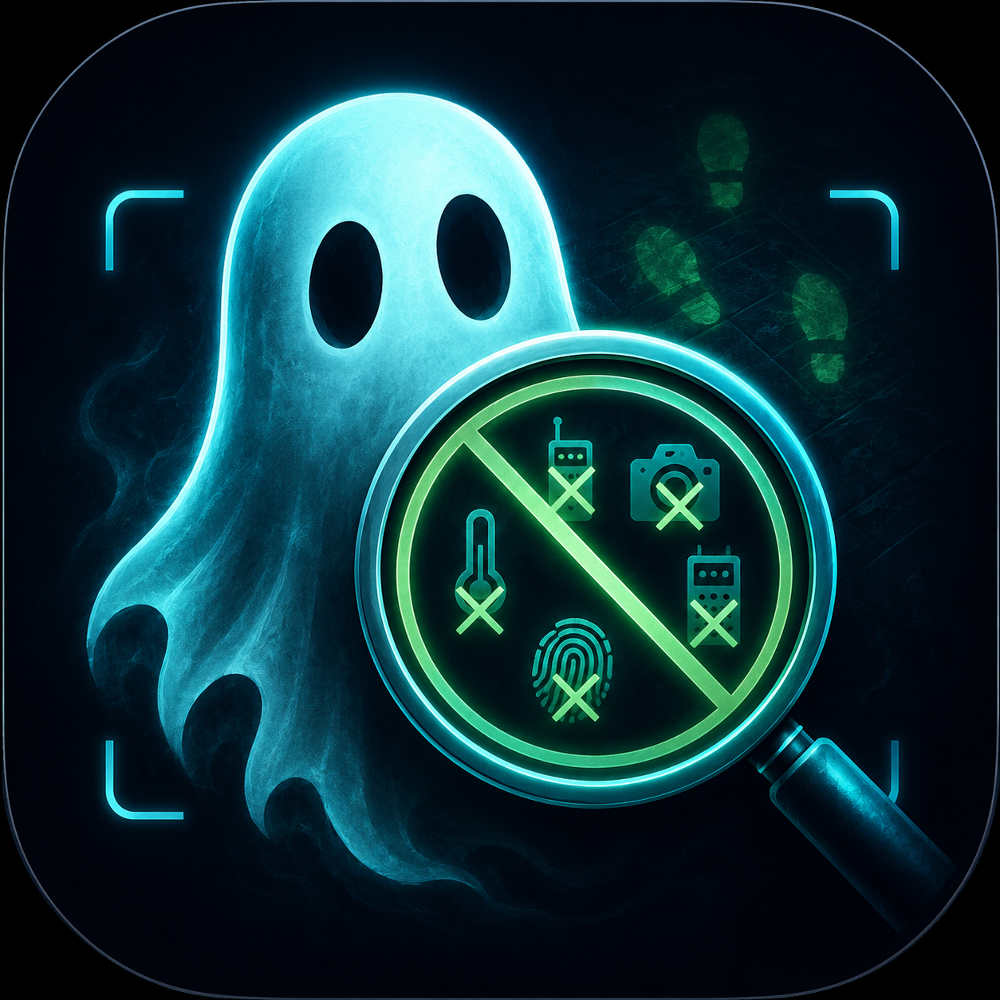
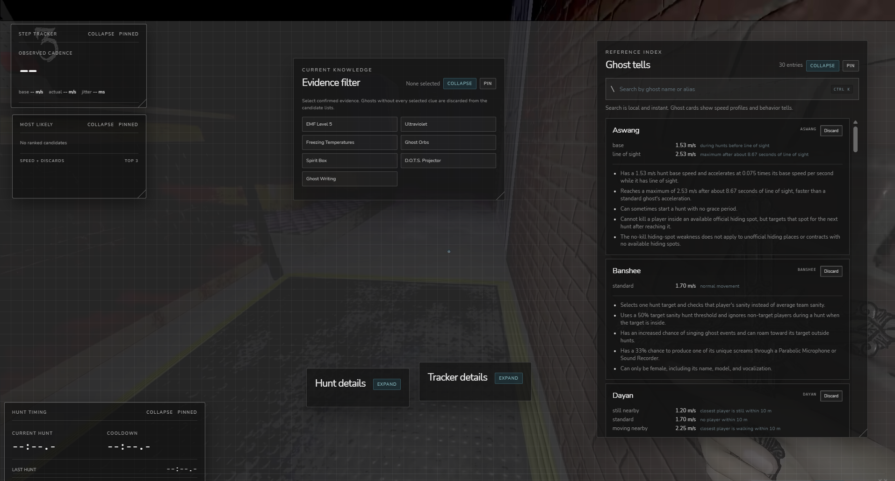

# Phasmo Field Kit

<p align="center">
  
</p>

<p align="center">
  A Windows desktop companion for manual, no-evidence Phasmophobia investigations.
</p>

<p align="center">
  
</p>

Phasmo Field Kit turns your observed footsteps into a practical ghost-speed shortlist. Tap along with footsteps, compare the measured speed against the ghost roster, track hunts, and keep the tools you need visible in a click-through in-game overlay.

> This is a measurement aid, not an automatic identifier. Missed steps, line of sight, conditional abilities, custom difficulty modifiers, and game updates can affect a result. Confirm a speed match with evidence and behavior.

## Features

- **Footstep BPM tracker** with median BPM from the latest eight valid intervals.
- **Speed estimates** for base and actual ghost movement speed, including a configurable difficulty modifier.
- **Ghost shortlist** ranked by measured speed, with a 0.175 m/s matching tolerance.
- **Evidence filtering** and session-only ghost discards to narrow the roster.
- **Ghost reference** with search by English name, alias, or Spanish localized name.
- **Hunt tools** for hunt duration, post-hunt cooldowns, and Demon, Spirit, Moroi, Yurei, and Obambo timing tests.
- **Global keybinds** for taps, resets, the overlay, and hunt timers.
- **Pin-and-place modules** with persistent size, position, and pin state.
- **Windows overlay mode** that is transparent, click-through, monitor-sized, and only visible while Phasmophobia is foregrounded.

## Quick Start

### Prerequisites

- Go 1.25+
- Node.js 20.19+ or 22.12+
- [Wails v2.13+](https://wails.io/docs/gettingstarted/installation/)

### Run locally

```bash
npm ci --prefix frontend
wails dev
```

### Build for Windows

```bash
wails build
```

The packaged executable is written to `build/bin/`.

## How To Use

1. Start an investigation and press `Space` for each footstep you hear.
2. After enough taps, check the BPM and base-speed estimate in the **Step Tracker**.
3. Use the resulting ghost shortlist alongside evidence and behavior tells.
4. Pin the modules you need, then press `F8` to enter the in-game overlay.
5. Use **Start hunt** and **End hunt** to record hunt and cooldown timings.

Drag modules by their headings and resize from the bottom-right corner. Positions, sizes, pin state, keybinds, and settings persist between sessions.

## Default Keybinds

| Action | Key |
| --- | --- |
| Record a footstep | `Space` |
| Reset tracker and timers | `F7` |
| Toggle pinned overlay | `F8` |
| Open settings | `F9` |
| Start hunt timer | `F10` |
| End hunt timer | `F11` |
| Reset the full session | `F12` |

Full-session reset clears the tracker, timers, selected evidence, and discarded ghosts. Keybinds can be changed in Settings.

## Data And Method

The footstep tracker uses the community conversion model:

```text
base speed = BPM / (modifier * (60 + BPM * 0.095))
```

At a 100% modifier, a 1.7 m/s standard ghost is approximately 121.6 BPM. The conversion offset is named and configurable in `internal/bpm/model.go` so it can be recalibrated after a game update.

The embedded catalog contains the current 30-ghost roster through Deildegast, including evidence, conditional speed profiles, and behavior tells. Its initial speed profiles and ghost data draw from:

- [Veknmo](https://github.com/ArshdeepGadhri/veknmo)
- [Pro Game Guides: Ghost moving speeds](https://progameguides.com/phasmophobia/all-ghosts-moving-speeds-in-phasmophobia/)
- [Phasmophobia Wiki: Ghosts](https://phasmophobia.fandom.com/wiki/Ghost)
- [Phasmophobia Wiki: Deildegast](https://phasmophobia.fandom.com/wiki/Deildegast)

## Development

Run the full test suite after building the frontend, which is embedded by the Go application:

```bash
npm run build --prefix frontend
go test ./...
```

For isolated domain tests that do not require the frontend build:

```bash
go test ./internal/...
```

## Stored Settings

On Windows, preferences are saved under `%APPDATA%\PhasmoHelper`:

- `settings.json` stores keybinds and tracker preferences.
- `overlay-layout.json` stores module layout and pin state.
